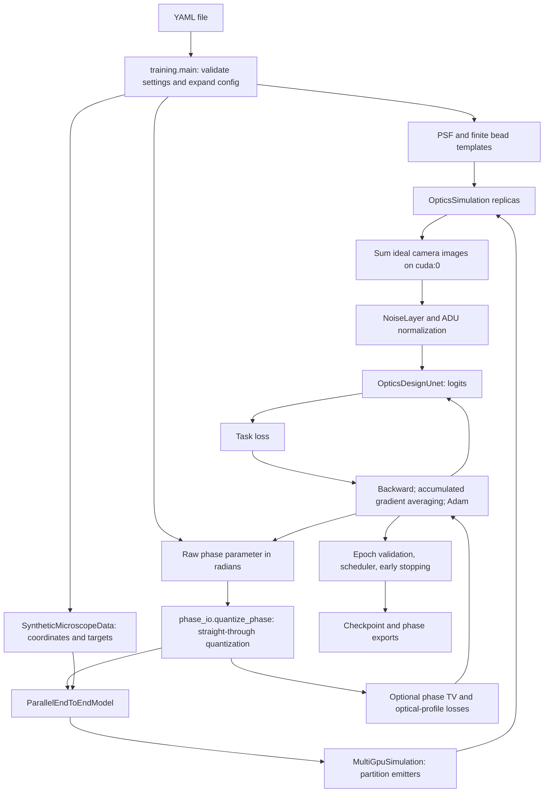

# Existing code architecture

Verified against branch `feature/multi-gpu-opt`, commit `a331967c3ca2882d4c09bfd1f7c1607cd90cdbce`, on 2026-11-03. This describes the implementation, not the proposed research architecture. Check relevant source when working on a later commit; update this document when changing a contract. Documentation-only changes made after that commit do not change the mapped execution path.

## 1. Purpose and scope

A scheduler requeue after a verified successful segment receipt is an idempotent
no-op even when the restart counter exceeds the work-restart limit. Identity,
configuration, GPU type, checkpoint hash and epoch are checked first; the limit
still blocks any additional training. This avoids converting completed training
into a failed dependency solely because of a late fourth preemption.


`physics/exposure.py` validates optional fixed camera signal scaling; default
`auto_percentile` preserves historical exposure. `NoiseLayer.scale_for` exposes
the applied coefficient without changing the noise draws. ASM optionally returns
detached L2 power diagnostics with the unchanged field. `scripts/evaluate_fixed_dose.py`
uses common input illumination, independent Gaussian calibration scenes and paired
test scenes/noise to measure relative fixed-total-incident-dose performance.
See [fixed-dose.md](fixed-dose.md) for dose plane, multi-view accounting, numerical
crop/filter losses, units and limits on physical interpretation.


`scripts/slurm/prepare_frozen_gaussian_study.py` prepares the explicit twelve-run
frozen-Gaussian baseline/class-weight grid. It validates a per-run budget and a
resource assignment for every arm, bounds BME usage and renders immutable scripts.
See [frozen-gaussian-study.md](frozen-gaussian-study.md) for class-weight ratios,
sample geometries, constant optical penalties and scheduler interpretation.


`freeze_slm: true` disables raw-phase autograd as well as excluding phase from
Adam. Detector gradients remain enabled. Every completed checkpoint verifies
bitwise unchanged raw phase against the segment's starting phase. Segmented
launches request a nonzero phase gradient only for trainable masks; explicitly
combining `--require-phase-gradient` with a frozen mask fails clearly. Frozen
optical penalties have no detector gradient and should be interpreted as fixed
illumination scores rather than beam optimization.


Optional `emission_strength_range: [minimum, maximum]` adds a relative photon
multiplier as emitter column four. Targets use the original xyz coordinates;
validation/checkpoints retain brightness. The default `[1,1]` retains the legacy
three-column scene and RNG sequence. `OpticsSimulation.forward` shares one
illumination calculation across detection focal views and interpolates intensity
PSFs for fractional pixel defocus. Expanded PSF canvas/depth includes focal offsets.
See [phase-transfer.md](phase-transfer.md) for the scientific and execution contract.
`maximum_training_seconds` stops after a verified completed epoch;
`training.segments` supports bounded scheduler requeues with execution identity,
configuration and GPU checks, requiring an advancing checkpoint.


`scripts/update_final_report.py` adds final checkpoint loss histories, camera-only
panels, and learned/Gaussian/axicon/Airy width tables at the center and sampled
FOV edges. It operates on saved artifacts and prepares the same HTML for
browser-based PDF export; see [optical-evaluation.md](optical-evaluation.md).

`physics.masks.focused_airy_phase_parameters` implements the opt-in focused,
rotated Airy initializer. `airy_phase_mode: focused` requires a sampled,
explicit-alpha recipe; absent settings retain the historical cubic-only mode.
The same phase constructor is used by `scripts/airy_orientation_debug.py` and
analytic reference capture. See [optical-evaluation.md](optical-evaluation.md)
for units, rotation convention, focusing/origin carrier and sampling guard.
Optical power intervals preserve zero-intensity CDF plateaus, avoiding power
interpolation across clear regions.

The latest optical audit adds `utils/beam_metrics.py` (1/e lobe width, 63% power
sectioning and censored OS-doubling ranges), `scripts/optical_report.py` (camera
noise/scaling, equal-aspect crops, per-class metrics and x–z bead overlays),
`scripts/airy_parameter_debug.py` (bounded allocated Airy estimates) and
`scripts/matched_bead_evaluation.py` (common-volume cross-evaluation without
retraining). `scripts/slurm/study_status.py` audits original/recovery allocations;
`scripts/recover_training_boundary.py` verifies saved boundaries after failed
allocations. See [optical-evaluation.md](optical-evaluation.md) for scientific
contracts, censoring, units, normalization, matched-control limitations and
explicit allocation bounds. Beam displays now normalize each type independently
on a linear scale; raw intensity arrays remain unchanged.

`scripts/evaluate_tissue_study.py` evaluates immutable interim v2 checkpoint
snapshots for both binary and three-class tissue studies. It saves exact camera
inputs, class confusion matrices, raw/quantized phase radians, and matched
learned/Gaussian/axicon scan-integrated profiles on independent per-beam linear scales. One-sided
comparisons additionally capture an analytic Airy reference without repeating
saved scene inference. Combined galleries can append completed Dice + BCE
baselines while labeling differences in geometry and training budget. Spatial geometry and throughput
penalties are plotted directly from input settings. GPU capture supports one or two allocated GPUs after verifying identical saved
optical replica buffers; it strictly retains all detector state. Phase/cost plotting and saved-array rendering are CPU operations.
See [tissue-study-evaluation.md](tissue-study-evaluation.md) for axes, normalization,
seeds, exposure assumptions, snapshot validation and diagnostic limits.

Segmented short-allocation execution is implemented in `training/segments.py`.
It preserves strict v2 checkpoint continuation, cumulative observed work counters,
a configurable minimum actual training-time gate, and fail-closed predecessor
receipts. `training/model_archive.py` preserves a frozen complete inference bundle
rather than relying on a model-only pickle. See
[segmented-training.md](segmented-training.md) for the explicit bounded plan,
logical GPU and fresh-process contracts. Existing scientific configs are not
silently reduced when resuming.

An opt-in tissue-aware optical objective is documented in
[tissue-aware-objective.md](tissue-aware-objective.md). `training/tissue_loss.py`
uses raw `[propagation x, thickness z]` profiles with per-position activation
checkpointing and a fixed Gaussian reference; `physics/wrappers.py` returns its
profile/axis dictionary when `tissue_spatial_loss_weight` is positive. This is
separate from the historical normalized spatial-well path. An optional
`tissue_sample_z_bounds_um` restricts fluorescent bead-centre support in depth.

Saved-artifact analysis tools added on 2026-11-09 are documented in
[research-archive-review.md](research-archive-review.md). The three
`scripts/*archive*.py` entry points inventory and visualize existing histories,
TIFF predictions/profiles and cached sample coordinates without running training
or optical inference. Their pixel metrics and normalized profiles have the
limitations described there.

`scripts/evaluate_checkpoint.py` (2026-11-11) captures trained binary inference
from a complete v2 checkpoint on exactly two allocated GPUs, saving the exact
camera tensor passed to the detector, fresh and cached-validation scenes, and
raw learned/flat-reference beam profiles through the renderer's sample_4f path.
Its CPU renderer creates pixel confusion matrices, fixed-threshold point metrics
and figures without executing optical inference. It never trains or resumes.
See [checkpoint-evaluation.md](checkpoint-evaluation.md) for limits and artifacts.

The software jointly optimizes an illumination phase mask and a bead-detection network using differentiable synthetic image formation. It also supports optical-profile penalties and phase-only optimization with a frozen network. It is not yet a calibrated digital twin of the experimental microscope, a layered air–glass–water simulator, or an SLM device-control system.

Primary references: [training driver](../training/training.py), [optical simulation](../physics/simulation.py), [network wrapper](../models/wrappers.py). The original README lists historical filenames missing from this checkout; use the module paths below for current development.

## 2. One training step



The optical-profile penalty requests a separate propagation through replica 0; it is not computed from U-Net logits. It uses normalized/collapsed profiles rather than a calibrated photon budget.

## 3. Module ownership

| File | Responsibility and important symbols |
|---|---|
| [training/training.py](../training/training.py) | `main`, `train_one_epoch`, `validate_one_epoch`, `compute_total_loss`; owns raw phase, Adam, scheduler, validation cache, exports and epoch lifecycle. Defines Dice, TV integration, spatial well and early stopping. |
| [training/checkpoint.py](../training/checkpoint.py) | `read_checkpoint`, `resume_config`, `save_checkpoint`, `restore_checkpoint`; complete v2 state and strict resume configuration. |
| [data/io.py](../data/io.py) | YAML loading, `expand_config`, derived grid/PSF settings, generic image/plot I/O. Generic display normalization is not hardware phase conversion. |
| [data/preprocessing.py](../data/preprocessing.py) | `generate_bead_templates`; generates the PSF and bead-defocus MAT files used by physics replicas. |
| [data/psf_gen.py](../data/psf_gen.py) | Homogeneous scalar PSF integration, hardcoded emission-weight averaging, camera-pixel supersampling, finite 2D bead template convolution. |
| [data/generators.py](../data/generators.py) | `create_random_emitters`; random bead positions and optional depth-coupled bead pairs/connection labels. |
| [data/datasets.py](../data/datasets.py) | Fresh synthetic training examples; cached `ValidationDataset`. Coordinates are sampled anew in each training `__getitem__`. |
| [data/transforms.py](../data/transforms.py) | Coordinates to binary, PSF-smoothed or three-class targets. Depth membership uses inclusive `z_range_cost_function`. |
| [models/wrappers.py](../models/wrappers.py) | `ParallelEndToEndModel`; physics then U-Net. Preserves parent train/eval mode, except frozen U-Net is explicitly placed in eval mode. |
| [models/unet.py](../models/unet.py) | `OpticsDesignUnet`; 2D/3D encoder-decoder producing raw logits. 2D uses InstanceNorm; 3D uses BatchNorm and optional dropout. |
| [physics/wrappers.py](../physics/wrappers.py) | `MultiGpuSimulation`; emitter partitioning, image aggregation, one camera-noise application, optional beam-profile calculation. |
| [physics/simulation.py](../physics/simulation.py) | `OpticsSimulation`; Gaussian input, lens alternatives, FFT propagation, scan collapse and PSF-weighted image rendering. Also noise/TV/legacy quantizer APIs and profiling helpers. |
| [physics/masks.py](../physics/masks.py) | `get_initial_phase_mask`; flat/random/analytical/file initial phase. File loading uses explicit phase I/O. |
| [physics/bessel.py](../physics/bessel.py) | Analytical axicon phase generation. |
| [physics/phase_io.py](../physics/phase_io.py) | Shared units contract, straight-through quantization, code-image export/load, metadata and circular resize. |
| [physics/phase_mask_norm.py](../physics/phase_mask_norm.py) | Thin array/file export adapters and CLI; target size/padding and carrier on final grid. |
| [utils/metrics.py](../utils/metrics.py) | Prediction metrics and logging used by inference; audit metric definitions before scientific interpretation. |
| [utils/debug.py](../utils/debug.py) | CUDA memory snapshots and device memory reporting. |
| [tests/test_review_fixes.py](../tests/test_review_fixes.py) | CPU regression tests, including mocked-physics driver continuation and accumulated update comparisons. |

## 4. Data, coordinates and gradients

Symbols: B=batch size; E=emitters; H/W=camera grid height/width; N=simulation grid side; S=number of detection focal planes (`Nimgs`); C=output classes.

| Boundary | Current contract |
|---|---|
| Emitter coordinates | `[B,E,3]`, transported as float32 but integer-valued grid positions. Index 0 is x/camera column and illumination propagation coordinate; index 1 is y/camera row and scan direction; index 2 is z/detection depth and sheet-thickness coordinate. Geometry is expressed in grid pixels. |
| Camera/image-volume configuration | `image_volume=[H,W,D]`; D defines sampled specimen depth, not the U-Net's channel count. `z_depth_list` selects detection focal planes. |
| Raw phase | `[M,M]` float parameter, radians, unbounded. Created separately from `model` in the training driver. Must be included separately in optimizer/checkpoint state. |
| Physical phase | Same shape before optional upsampling; wrapped and quantized according to `slm_bit_depth`. Forward uses quantized values, backward uses the straight-through estimator. This is a surrogate gradient, not a derivative of hard rounding. |
| Propagated field | Complex tensor; lens routes commonly produce `[1,1,N,N]`. Profiling can squeeze this to `[N,N]`. |
| Ideal/rendered image, 2D path | `[B,S,H,W]`. S acts as the U-Net input channel count. |
| Network output, 2D path | `[B,C,H,W]` raw logits, C=1 or 3. Loss classes own sigmoid/softmax; never apply them twice. |
| Dataset targets | `[1,H',W']` per sample; batched `[B,1,H',W']`. Binary float or integer class IDs 0=background, 1=bead, 2=connection. Default output ratio is 1; changing it needs shape validation. |
| 3D option | Physics can allocate `[B,1,S,H,W]`; network intends `[B,C,S,H,W]`. Existing target generation remains 2D, and the 3D network has unverified depth/skip dimensions. The full 3D path is not established by the loss-only 3D tests. |
| Spatial profile | `_compute_core_propagation` produces collapsed profiles `[P,T]` (propagation samples by thickness samples); `DynamicSpatialWellLoss` sums dimension 1, then normalizes and weights the remaining profile. Verify axes before changing the penalty: its current summation collapses T, so do not assume the remaining axis is thickness merely from variable names. |

The propagation kernel `angular_spectrum_propagation` accepts distance in **pixels**, then multiplies by `px` internally. Lens focal lengths/wavelength/beam width configuration are generally meters; profiler keys ending `_mm` are millimeters. Detection PSFs index absolute defocus in grid steps. Do not substitute illumination propagation depth for detection defocus.

Core backward path: loss → logits → camera simulation → illumination intensity → complex field → quantized phase → raw phase. Copies between devices can participate in autograd. NumPy conversion/detaching in this path breaks the raw-phase connection. Saving detached artifacts after backward is appropriate.

## 5. GPU and image-formation behavior

`MultiGpuSimulation` creates one `OpticsSimulation` per visible CUDA device and divides the emitter axis into chunks. Each replica receives the whole phase and computes its emitters' ideal image. Results are copied/summed on `cuda:0`; camera noise is applied once after summation. The U-Net is also hardcoded to `cuda:0`, although the driver exposes `cnn_device`. This is manual emitter parallelism, not DDP and not distributed training across nodes. A Python loop launching replicas does not by itself prove optimal concurrent execution.

The renderer currently repeats angular-spectrum propagation in nested detection-plane/batch/emitter loops. No unique-coordinate propagation cache is implemented. With the phase fixed during a forward, repeated propagation positions can potentially share calculations; benchmark and compare gradients before changing it. Hardware visibility is controlled by the allocation's `CUDA_VISIBLE_DEVICES`.

The advertised CPU fallback omits a required constructor argument, and the model wrapper hardcodes CUDA. CPU regression tests use isolated modules or a tiny substitute model; they do not show the full microscope model runs on CPU.

## 6. Configuration, objective and lifecycle

[config.yaml](../config.yaml) is a complete starting configuration; [batch_config.yaml](../batch_config.yaml) contains string placeholders to be replaced by batch submission. It is not directly runnable as a numeric configuration.

Important settings:

- `initial_phase_mask: gaussian`: explicit Gaussian-illumination initialization,
  using zero phase modulation of the simulator's existing incident Gaussian
  amplitude. It does not introduce a Gaussian-shaped phase function or change
  the beam width, optical route, exposure or noise settings. `empty` remains
  available for historical configurations.

- `z_coupled_lateral_jitter_px`: optional nonnegative integer, default 0 when
  absent for historical configurations. For z-coupled pairs only, the second
  bead receives an independent integer x/y displacement of at most +/- this
  many sample-grid pixels relative to the first. Endpoints stay in their allowed
  PSF-safe spatial ranges. Radius 0 preserves prior scenes and RNG consumption.
  Future config templates set 3. Three-class connection coordinates follow the
  jittered endpoints by rounded linear interpolation at intermediate z planes.
  See [bead-generation.md](bead-generation.md). Existing queued snapshots retain
  their original aligned-pair behavior.

- `accumulation_steps`: required positive integer; old `gradient_accumulation_steps` is rejected. Each microbatch mean loss is weighted by sample count; gradients are divided by window sample count immediately before Adam. This includes incomplete windows. Weighted CE's class-weight denominator and batch-dependent layers can differ from a literal concatenated-batch operation.
- `ce_loss_weight`, `dice_loss_weight`, `mae_loss_weight`, `mse_loss_weight`, `tv_loss_weight`, `spatial_multi_well_loss_weight`: specify actual objective. The current default sets all to zero and is rejected early. Do not silently choose the research objective for the user.
- `freeze_unet`, `freeze_slm`: optimization controls. Raw phase remains an external parameter; freezing SLM removes it from optimizer groups. The wrapper sets U-Net parameters nontrainable when frozen.
- `slm_bit_depth`: 8 by default; 10 supported. `quantize_slm` is a stale configuration flag: training quantizes regardless of that flag.
- `spatial_well_steepness`: fixed positive Python float; not trainable. Bounds and profiles are grid-based, not a physical-dose constraint.
- `resume_checkpoint`, `max_epochs`, `resume_reset_early_stopping`: resume control; see [review-fixes.md](review-fixes.md).

`expand_config` derives `px=slm_px/phase_mask_upsample_factor`, `N`, relay scale, PSF canvas and emitter safe bounds. It overwrites `image_volume[0]` and `spatial_well_y`. Inspect saved expanded configuration rather than assume raw YAML values were used unchanged. Physical SLM pitch versus effective demagnified pitch is not independently calibrated by this formula.

Training generates templates, builds model and raw phase, caches validation coordinates/targets, and creates DataLoaders with four workers. `ntrain/batch_size` is used as dataset length and then a DataLoader batch size is applied again: do not assume `ntrain` is the number of loader steps at batch sizes above 1. The renderer still generates new camera noise during validation. Scheduler/early stopping see mean validation loss.

## 7. File formats and checkpoints

An output run contains expanded `config.yaml`, `labels.pickle`, loss-history text files, PSF/bead MAT files, and:

```text
learned_phase_masks/
  radians/mask_phase_epoch_K.tif     float32 raw radians
  tif/mask_phase_epoch_K.tif         integer drive codes
  tif/mask_phase_epoch_K.tif.json    units/bit-depth metadata
  bmp/mask_phase_epoch_K.bmp        <=8 bits only, plus JSON
models/net_K.pt                     legacy inference model state only
checkpoints/latest.pt               atomic complete v2 checkpoint
resume_config.yaml                  written when resuming
```

Epoch filenames use zero-based K. For >8 bits use uint16 TIFF/PNG storage with code range 0..(2^bits−1), not a stretched 0..65535 display range. Preserve JSON sidecars. `phase_io.load_phase_config` uses metadata if present; legacy integer masks require explicit YAML input units. Float masks default to radians. Linear full-2pi quantization is a model assumption; vendor transport packing and measured phase LUT are not implemented here.

Checkpoint v2 includes network, raw phase, optimizer/scheduler, early stopping, RNG states, histories, fixed validation cases and raw/expanded config. `latest.pt` is written after a completed epoch; an interruption replays the unfinished epoch. Resume restores RNG after constructing the environment and keeps the saved run directory. Only listed run-control keys may differ. Same GPU count/order and compatible dependencies are required; actual CUDA determinism has not been demonstrated. v1 summed-gradient and old network-only files cannot be used for exact continuation.

## 8. Commands and execution surfaces

Run from repository root in the project environment. These describe current entry points, not a claim that all passed end-to-end HPC validation.

| Purpose | Entry point/status |
|---|---|
| CPU regression suite | `python -m pytest -q tests` (32 tests passed in prior validation with Python 3.10 / Torch 2.14.1 CPU). |
| Training/resume in an allocation | `python -m training.training --config PATH.yaml`. Full optical driver expects CUDA. |
| Current inference | `python inference.py --input_dir RUN --epoch K`; uses model weights, saved cases and phase-file loader. Loads network with `strict=False`; full compatibility must be checked. |
| Beam profile | `python beam_profiler.py --config RUN/config.yaml --mask MASK --output_dir DEST`. Uses expanded configuration. |
| Export | `python -m physics.phase_mask_norm INPUT OUTPUT --bit-depth 8` (or 10 with TIFF/PNG); see detailed unit/resize options in [review-fixes.md](review-fixes.md). |
| Combined profiling/inference | `python RunProfilerInference.py RUN K`; currently looks in legacy root mask paths or BMP subfolder, so new 10-bit training output is not discovered there. |
| LSF launcher | [scripts/lsf/submit_training.sh](../scripts/lsf/submit_training.sh) snapshots config and substitutes its path into [train_job.bsub](../scripts/lsf/train_job.bsub). Site environment/GPU requests are hardcoded. |
| Slurm launcher | [scripts/slurm/submit_training.sh](../scripts/slurm/submit_training.sh) currently references nonexistent `scripts/lsf/train_job.sbatch`; actual template is [scripts/slurm/train_job.sbatch](../scripts/slurm/train_job.sbatch). Treat launcher as needing repair before submission. |
| Batch sweeps | [scripts/lsf/submit_batch_training.sh](../scripts/lsf/submit_batch_training.sh) substitutes objective/geometry placeholders into configs and submits jobs; inspect loops/resource requests before execution. |
| Legacy inference | [mask_inference.py](../mask_inference.py), [cnn_inference.py](../cnn_inference.py), [physics_inference.py](../physics_inference.py) import old modules missing from this tree. Their phase loaders were migrated, but full scripts remain legacy. |
| Analysis/helpers | `FWHM_cal.py`, `fwhm.py`, `plot_sidelobe_curve.py`, `queue_inference_jobs.py`, `FullAxiconGenerator.py`, `RotateImage.py`, conversion/cluster wrappers. Inspect assumptions and paths before using them as scientific evaluation. |

There is no portable dependency lockfile; README requirements are historical. Do not assume latest Python/Torch or cluster module versions are interchangeable with the tested CPU environment. No live HPC connection or allocation is configured by this repository map.

## 9. Known modeling boundaries and hazards

These are navigation constraints, not authorization to repair everything in one task:

1. Homogeneous scalar propagation: no physical air–glass–water stack, wall thickness, refraction/tilt model or objective reference-aberration calculation. Optional synthetic Zernikes still have the previously identified method binding/unit issues; do not enable them as calibrated chamber correction.
2. NoiseLayer automatically rescales image intensity to a percentile target, and gain units conflict with a configuration comment. Existing losses do not establish fixed-power/fixed-dose performance.
3. Detection model is a homogeneous scalar PSF with hardcoded emission weights and `abs(defocus)` lookup. No depth-dependent asymmetric detection aberration model is implemented.
4. The finite bead template is a blurred 2D disk; a spatially resolved 3D bead requires different modeling.
5. The spatial penalty acts on normalized profiles, includes a dimension collapse and has finite support. Interpret axes and energy accounting from code; it is not independently validated sectioning performance.
6. Propagation padding/band limits, aperture/NA mapping and physical scale need independent convergence/calibration tests. Evanescent components are clamped but not masked; the stated default grid may not reach them.
7. Missing CPU fallback, full 3D target/shape alignment, scheduler paths, and legacy inference are separate tasks. Existing tests do not validate the full CUDA forward/backward chain, multi-GPU equivalence, vendor display, or experimental improvement.

## 10. Where to work for a given objective

### Slurm multiprocessing preflight (2026-11-09)

`scripts/slurm/monitor_benchmark_queue.py` provides bounded login-node monitoring
of the manifest's existing benchmark job. It may retarget only that pending job
between typed L40/L40S (48 GB) and H100 (80 GB) pairs when both node resources and
the reported short-QOS quota permit. It preserves two GPUs, the wall-time cap,
job ID and dependencies; it never submits or cancels jobs. The capacity helper is
cached, so Slurm remains authoritative. H200 pairs exceed the current per-job
short-QOS H200 cap, and Blackwell is excluded pending validation of the frozen
Torch/CUDA runtime. Progress/state is written to the selected JSON path; the
monitor stops at its explicit duration or a terminal job state.

The full trainer now accepts runtime-only CLI controls: `--run-dir` creates a
visible top-level result folder; on resume it must match the checkpoint folder.
`--worker-timeout 60` bounds failed DataLoader transfers. `--progress-every 32`
writes first/periodic batch progress to stdout and `live_progress.json`.
`--require-phase-gradient` verifies the first raw-phase gradient is finite and
nonzero. These flags do not alter the scientific YAML or accumulation algorithm.
`training/runtime.py` records complete train/validation/save cycles, verifies
checkpoint epoch/history by reading v2 state back, and records
`epoch_timings.json`/`last_checkpoint.json`. With `--wall-seconds` and
`--stop-margin-seconds`, another epoch starts only when 1.25 times the slowest
measured cycle plus the margin fits. Stops occur only after a saved epoch;
an unexpectedly long first/new epoch is still not rescued by a warning signal.
`scripts/slurm/prepare_phase_sweep.py` prepares, but never submits, one short
32/8 benchmark and the full-count random/gaussian/axicon runs. Each uses an
immutable code/config/script snapshot and the short-IPC worker preflight. The
full jobs require a verified benchmark checkpoint marker before starting.

`scripts/slurm/worker_runtime.sh` uses a short node-local `/tmp` directory for
transient worker IPC sockets, with cleanup on shell exit. Scientific artifacts
remain in Git-ignored run folders inside the checkout. Deep absolute experiment
paths exceed the AF_UNIX socket limit and stalled the 2026-11-06 sweep before
its first epoch. `python -m utils.worker_preflight` tests real four-worker Torch
tensor transfer with a bounded timeout before training. As of 2026-11-11 its
loader bound defaults to 60 seconds, matching training, and its parent allows
120 additional seconds for interpreter/import/teardown overhead. It prints timed
import/transfer stages and accepts `--report PATH` for an atomic success/failure
record including host and timeout details. Failure remains fatal; there is no
automatic retry or worker-count fallback. This mitigates the earlier 10-second
startup timeout but does not establish a node-specific root cause.
Archived submitted scripts
are preserved as evidence; they must not be reused unchanged. No trained weights
or epoch loss histories were produced by that failed sweep.

`scripts/weekend_diagnostics.py capture` renders initialized (untrained) networks
and the saved scene geometry on allocated GPUs; `render` creates CPU diagnostic
plots. It captures the exact camera tensor passed to the detector, rather than
rerendering a second camera-noise realization for display. Outputs are explicitly
untrained references, not learned-performance estimates. Color-coded 3D beads
associate the 2D prediction with known x,y projections; they do not infer depth
or attribute a false positive uniquely to an out-of-focus bead. The HTML view is
self-contained and rotatable; static PNGs, raw NPZ arrays, CSVs and pixel metrics
are also saved. Missing epoch histories are labeled unavailable rather than
plotted as zero loss.

### Bounded Hazel pilot entry point (2026-11-04)

The local Slurm launcher path has been repaired and launches training as a Python
module. The earlier table describes the reviewed commit, before these local fixes.
[`training/pilot.py`](../training/pilot.py) is a separate bounded runner using the
existing model/loss/accumulation and v2 checkpoint functions; it does not change
the historical trainer. [`scripts/slurm/pilot_control.py`](../scripts/slurm/pilot_control.py)
captures/verifies code and YAML snapshots, renders scripts and gates matched arms.
It never submits jobs. See [hazel-pilot.md](hazel-pilot.md) for configuration,
coordinate/profile tests, auto-exposure labels, timing controls and continuation
contracts. GPU correctness depends on the recorded smoke result, not CPU tests.

- Training correctness/resume: training driver + checkpoint + tests; protect raw phase and optimizer ownership.
- New physical cost function: dispatcher + criterion + profile definitions; specify units, axes, normalization and constraints before optimization.
- Chamber model: physics simulation + pupil/grid geometry + independent reference tests; separate illumination and detection.
- Performance: renderer + GPU wrapper; compare images, raw-phase gradients, wall time and peak memory.
- Hardware export: phase_io + adapters; preserve typed metadata and training/export agreement.
- HPC operations: scheduler scripts and environment documentation; validate commands offline before using an allocation.

Use [agent-task-template.md](agent-task-template.md) to assign one bounded task. Read [research-intent.md](research-intent.md) for user objectives and unresolved instrument details.
